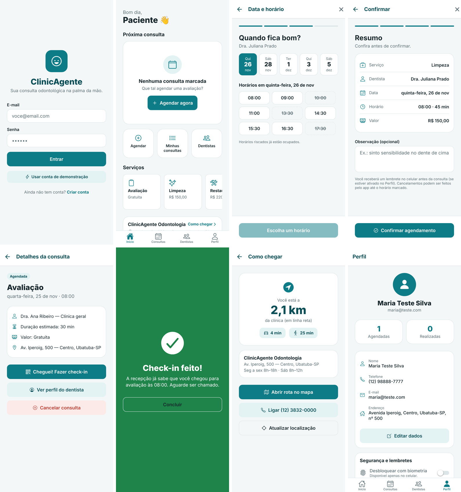

# 🦷 ClinicAgente Mobile

**O app do paciente da clínica odontológica: agende em 4 toques, receba lembrete no celular, chegue guiado pelo GPS e faça check-in na recepção lendo um QR Code. Sem fila e sem ligar para a clínica.**

O ClinicAgente nasceu como sistema web (Next.js + Supabase) em outra disciplina, voltado para a gestão da clínica (dono, dentista e recepção). Este app **não é uma cópia reduzida do site**. Ele resolve o lado do paciente com recursos que só o celular oferece: biometria, notificações locais, GPS, câmera e vibração.



> Da esquerda para a direita: login · início · escolha de horário · confirmação · detalhe da consulta · check-in por QR Code · distância até a clínica (GPS) · perfil com biometria e lembretes.

---

## 📱 Recursos nativos (o que a versão web não tem)

| Recurso | Onde aparece no app | Biblioteca |
|---|---|---|
| **Câmera + leitura de QR Code** | Detalhe da consulta → "Cheguei! Fazer check-in" | `expo-camera` |
| **Geolocalização** | Início → cartão da clínica → "Como chegar" (distância e tempo estimado, rota no app de mapas) | `expo-location` |
| **Autenticação biométrica** | Perfil → "Desbloquear com biometria" (pede digital/rosto ao abrir o app) | `expo-local-authentication` |
| **Notificações locais** | Lembrete automático 24h antes (ou 1h antes) de cada consulta; tocar na notificação abre a consulta | `expo-notifications` |
| **Feedback háptico** | Vibração leve em todo botão; vibração de sucesso, alerta ou erro em ações críticas | `expo-haptics` |
| **Modo offline / cache local** | Sessão, contas, consultas e preferências ficam no aparelho e funcionam sem internet | `@react-native-async-storage/async-storage` |
| **Ergonomia mobile-first** | Abas inferiores, modal deslizante, "puxar para atualizar" na lista de consultas | `expo-router` |

Também usa uma **API real**: o cadastro busca o endereço pelo CEP no [ViaCEP](https://viacep.com.br), com os estados de carregando, erro e sucesso.

## ✨ Funcionalidades

- Login, cadastro com validação e busca de endereço por CEP
- Sessão salva: fechar e abrir o app não desloga
- Rotas protegidas: sem login só existem as telas de login e cadastro
- Agendamento em 4 etapas (serviço → dentista → data/horário → confirmação), aberto como modal
- Só aparecem os dentistas que fazem o serviço e os dias em que cada um atende; horários ocupados ficam riscados
- Consultas próximas × histórico, cancelamento com confirmação
- Check-in na recepção por QR Code
- Distância até a clínica e rota no app de mapas
- Desbloqueio por biometria e lembretes configuráveis no Perfil

## 🚀 Como rodar localmente

**Pré-requisitos:** [Node.js](https://nodejs.org) 20 ou superior e o app **Expo Go** no celular ([Android](https://play.google.com/store/apps/details?id=host.exp.exponent) / [iOS](https://apps.apple.com/app/expo-go/id982107779)).

```bash
# 1. Clonar o repositório
git clone https://github.com/Williamsantxs/clinicagente-mobile.git
cd clinicagente-mobile

# 2. Instalar as dependências
npm install

# 3. Iniciar o servidor de desenvolvimento
npx expo start
```

4. Com o celular **na mesma rede Wi-Fi** do computador, abra o Expo Go e leia o QR Code que aparece no terminal (no iPhone, use a câmera do próprio celular).
5. Se a rede da faculdade bloquear a conexão, use `npx expo start --tunnel`.

**Conta de demonstração** (também há um botão na tela de login que preenche):

| E-mail | Senha |
|---|---|
| `paciente@clinicagente.com` | `123456` |

### Como demonstrar os recursos nativos

- **Check-in:** agende uma consulta, abra o detalhe, toque em "Cheguei! Fazer check-in" e aponte a câmera para [`docs/qrcode-checkin.png`](docs/qrcode-checkin.png) (aberto em outra tela ou impresso).
- **Notificação:** Perfil → "Testar notificação (5 s)" → minimize o app → toque na notificação: o app abre direto na próxima consulta.
- **Biometria:** Perfil → ative "Desbloquear com biometria" → feche o app por completo e abra de novo.
- **GPS:** Início → toque no cartão "ClinicAgente Odontologia" → permita a localização.

> No navegador (`w` no terminal) o app abre, mas biometria e notificações só funcionam no celular.

## 📦 Dependências

| Pacote | Para quê |
|---|---|
| `expo` (SDK 58) | Plataforma e ferramentas de desenvolvimento |
| `react` / `react-native` | Base da interface nativa |
| `expo-router` | Navegação baseada em arquivos (pilhas, abas, modais, rotas dinâmicas) |
| `react-native-screens` / `react-native-safe-area-context` | Telas nativas e respeito ao entalhe/barra do sistema |
| `expo-camera` | Câmera e leitura de QR Code |
| `expo-location` | GPS |
| `expo-local-authentication` | Digital / reconhecimento facial |
| `expo-notifications` | Notificações locais agendadas |
| `expo-haptics` | Vibração |
| `@react-native-async-storage/async-storage` | Armazenamento local persistente |
| `@expo/vector-icons` | Ícones (Ionicons) |
| `expo-linking` / `expo-constants` / `expo-status-bar` | Links externos (mapa e telefone), configuração e barra de status |
| `react-dom` / `react-native-web` / `@expo/metro-runtime` | Execução no navegador para testes |

## 🗂️ Estrutura do projeto

```
src/
├── app/                    ← ROTAS (cada arquivo = uma tela)
│   ├── _layout.js          ← pilha raiz, proteção de rotas, bloqueio biométrico
│   ├── login.js · cadastro.js · clinica.js · +not-found.js
│   ├── (tabs)/             ← menu inferior: index, consultas, dentistas, perfil
│   ├── agendar/            ← modal com pilha própria: 4 etapas
│   ├── consulta/[id].js    ← rota dinâmica
│   ├── dentista/[id].js    ← rota dinâmica
│   └── checkin/[id].js     ← câmera em tela cheia
├── components/             ← componentes reutilizáveis (design system)
├── context/                ← estado global: AuthContext e ConsultasContext
├── hooks/                  ← custom hooks: useLocalizacao, useCep, useAbrirPelaNotificacao
├── services/               ← armazenamento, notificações, biometria, vibração
├── data/clinica.js         ← dados da clínica (mock)
├── utils/                  ← datas, alertas, texto
└── theme.js                ← cores e espaçamentos
```

A arquitetura de navegação está explicada em **[docs/ARQUITETURA.md](docs/ARQUITETURA.md)**.

O documento dos 4 pilares (motivação, grupo, desafios e benchmarking) está em **[docs/ClinicAgente-Mobile-4-Pilares.pdf](docs/ClinicAgente-Mobile-4-Pilares.pdf)**.

## ⚠️ Limitações conhecidas

- Os dados ficam **só no aparelho** (modo offline). Dois celulares não compartilham consultas. O próximo passo é ligar no Supabase do ClinicAgente web: só `src/context/` e `src/services/` mudam, as telas não.
- As senhas ficam no armazenamento local sem criptografia. Aceitável num protótipo acadêmico; em produção seria usado o Supabase Auth.
- Os horários "ocupados por outros pacientes" são simulados.
- Para facilitar a demonstração, o check-in é liberado para qualquer consulta agendada, não só no dia.
- No Expo Go aparecem avisos amarelos do `expo-notifications` sobre notificações *push*. O app usa só notificações *locais*, que funcionam normalmente.

## 👥 Squad

| Nome completo | RGM | Papel | GitHub |
|---|---|---|---|
| William dos Santos Souza | 43650171 | Mobile Frontend Developer · Arquitetura & Hooks / Dados | [@Williamsantxs](https://github.com/Williamsantxs) |
| Suel Gomes | 41919998 | UI/UX & Design System · QA & Documentação | [@suelgomes](https://github.com/suelgomes) |

Projeto acadêmico, disciplina de desenvolvimento mobile — Análise e Desenvolvimento de Sistemas, Universidade Cruzeiro do Sul, 2026.
